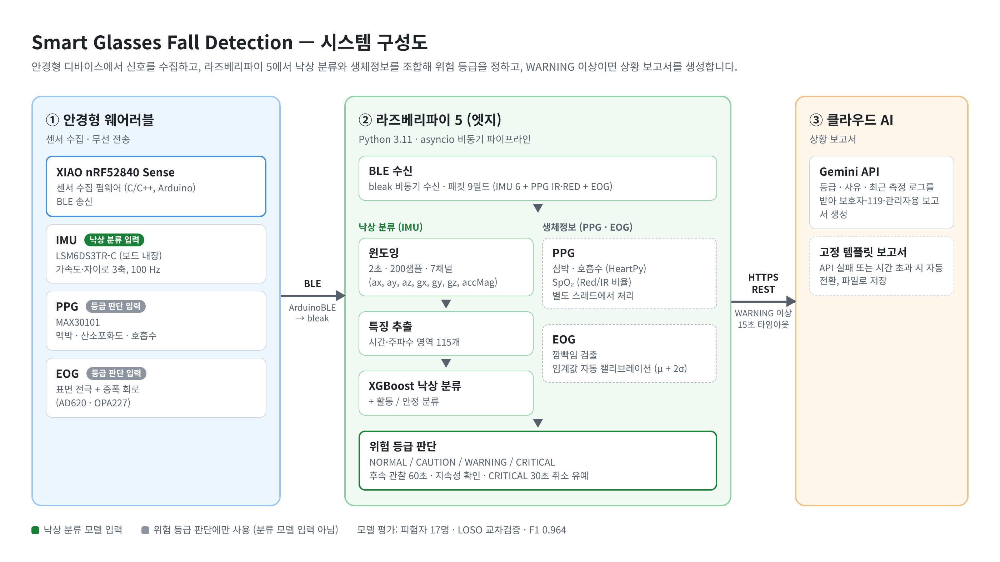

# Smart Glasses Fall Detection

**다중 생체신호 기반 안경형 웨어러블 낙상 감지 시스템**

안경형 웨어러블 디바이스에 PPG, 가속도, EOG 센서를 통합하여 낙상을 실시간으로 감지하는 연구 프로젝트입니다. XIAO nRF52840 기반 임베디드 디바이스에서 신호를 수집하고, 라즈베리파이 5에서 IMU 기반 머신러닝 모델로 낙상을 분류한 뒤, 생체정보(PPG·EOG)와 함께 위험 등급을 판단합니다.


---

## 🎯 프로젝트 개요

고령자 낙상은 심각한 건강 문제이지만, 기존 손목형·흉부형 웨어러블은 착용 거부감이 크고 머리·상체 움직임 정보를 반영하기 어렵습니다. 본 프로젝트는 **일상적으로 착용하는 안경 형태**에 다중 생체신호 센서를 통합하여, 자연스러운 착용 경험 안에서 낙상을 정확히 감지하는 것을 목표로 합니다.

### 핵심 기여
- **안경형 폼팩터**에 PPG·가속도·EOG 3종 센서 통합
- 피험자 17명 데이터로 **XGBoost 기반 낙상 분류기** 학습
- **F1 0.964, ROC-AUC 1.000** 성능 달성 (LOSO 교차 검증)
- XIAO nRF52840 ↔ 라즈베리파이 5 **BLE 실시간 파이프라인** 구축
- 낙상 분류 결과와 생체정보를 조합한 **4단계 위험 등급** (NORMAL / CAUTION / WARNING / CRITICAL)
- WARNING 이상에서 **Gemini API**로 상황 보고서 생성, 15초 타임아웃·호출 실패 시 **고정 템플릿 보고서로 자동 전환**

---

## 📊 성능 지표

피험자 단위 교차검증 (Leave-One-Subject-Out, 17-fold) 결과:

| 지표 | 값 |
|---|---|
| **F1 Score** | 0.964 ± 0.045 |
| **Sensitivity (민감도)** | 0.981 ± 0.037 |
| **Specificity (특이도)** | 0.996 ± 0.005 |
| **ROC-AUC** | 1.000 ± 0.001 |

> 민감도 98.1%: 실제 낙상의 98.1%를 놓치지 않고 감지  
> 특이도 99.6%: 일상 동작을 낙상으로 오탐할 확률 0.4%

---

## 🏗 시스템 아키텍처



<details>
<summary>텍스트 버전</summary>

```
┌─────────────────────────────────────────────┐
│         안경형 웨어러블 디바이스              │
│  ┌────────────────────────────────────┐   │
│  │  XIAO nRF52840 Sense               │   │
│  │  ├─ 내장 IMU (LSM6DS3TR-C, 100Hz) │   │
│  │  ├─ PPG 센서 (MAX30101)           │   │
│  │  └─ EOG 전극 (표면 부착)          │   │
│  └────────────────────────────────────┘   │
└─────────────────────────────────────────────┘
                   ↓ BLE (ArduinoBLE)
┌─────────────────────────────────────────────┐
│         라즈베리파이 5 (엣지 컴퓨팅)         │
│  ┌────────────────────────────────────┐   │
│  │  신호 수신 (bleak)                 │   │
│  │  → 윈도잉 (2초 / 200샘플)          │   │
│  │  → 특징 추출 (시간·주파수 영역)   │   │
│  │  → XGBoost 추론 (IMU)              │   │
│  │  → PPG 생체정보 · EOG 깜빡임 계산  │   │
│  │  → 4단계 위험 등급 판단            │   │
│  └────────────────────────────────────┘   │
└─────────────────────────────────────────────┘
                   ↓ HTTPS REST (async, WARNING 이상)
┌─────────────────────────────────────────────┐
│   Gemini AI (상황 보고서) / 실패 시 템플릿   │
└─────────────────────────────────────────────┘
```

</details>

### 위험 등급 판단

낙상 분류 모델의 입력은 IMU뿐이며, PPG·EOG는 분류 결과와 함께 위험 등급을 정하는 데 사용됩니다.

| 등급 | 조건 | 처리 |
|---|---|---|
| **NORMAL** | 이상 신호 없음 | 로그만 기록 |
| **CAUTION** | 낙상 감지 단독, 또는 생체 이상 1개 이상 | 낙상: 60초 동안 활동 복귀 관찰 · 생체 이상: 연속 3개 윈도우 지속 여부 확인 |
| **WARNING** | 낙상 + 생체 이상, 낙상 후 60초 무동작, CAUTION 지속 | Gemini 보고서 요청 |
| **CRITICAL** | EOG 깜빡임 저하 + (낙상 또는 생체 이상) | 30초 취소 유예 후 보고서 요청 (활동 감지 시 자동 취소) |

- 생체 이상 기준은 활동 상태(활동 / 안정)에 따라 다르게 적용 (안정 시: 심박 60–100, 호흡 12–20, SpO₂ 95% 이상)
- EOG 깜빡임 임계값은 시작 후 30초 측정값으로 자동 캘리브레이션 (μ + 2σ), EOG 단독으로는 등급을 올리지 않음
- 낙상 판정은 분류 점수 0.5 이상 기준이며, 점수는 확률 보정을 거치지 않은 분류 점수임

---

## 🛠 기술 스택

### 임베디드
- **MCU**: Seeed XIAO nRF52840 Sense
- **IMU**: LSM6DS3TR-C (내장, I2C, 100Hz 샘플링)
- **PPG**: MAX30101 (맥박·호흡수·산소포화도)
- **EOG**: 표면 부착 전극 + 증폭 회로
- **언어**: C/C++ (Arduino)
- **통신 라이브러리**: ArduinoBLE

### 엣지 (라즈베리파이 5)
- **언어**: Python 3.11
- **BLE 수신**: `bleak` (비동기)
- **신호처리**: NumPy, SciPy, HeartPy (PPG 심박·호흡수), Red/IR 비율 기반 SpO₂ 추정
- **ML**: scikit-learn, XGBoost
- **AI API**: `google-generativeai`
- **비동기 처리**: asyncio

### 통신 프로토콜
- **디바이스 ↔ 엣지**: BLE (XIAO SENSOR 서비스)
- **엣지 ↔ 클라우드**: HTTPS REST API
- **디버그**: UART Serial (115200 baud)

---

## 📚 머신러닝 파이프라인

### 데이터셋 (피험자 17명)
| 카테고리 | 종류 | 세션 수 |
|---|---|---|
| **낙상** | 4종 (전방·후방·좌측·우측) | 각 10회 |
| **비낙상 이산 동작** | 9종 (jump, pick_up, fast_sit, lie_down, squat, stand_up, stumble, up_stair, down_stair) | 각 10회 |
| **비낙상 연속 동작** | 5종 (walk_slow, walk_fast, run, sit_static, stand_static) | 각 60초 × 2회 |

### 처리 흐름
1. **윈도잉**: 2초(200샘플) 슬라이딩 윈도우, 7채널 (ax, ay, az, gx, gy, gz, accMag)
2. **특징 추출**: 윈도우당 **시간 영역** (mean, std, min, max, range, RMS, MAD, IQR, skew, kurtosis) + **주파수 영역** 특징 추출
3. **모델 비교**: 여러 분류기 교차 검증 후 **XGBoost 선정**
4. **실시간 추론**: 라즈베리파이에서 로드된 모델로 매 윈도우 분류
5. **위험 등급 판단**: 낙상 분류 결과 + 생체정보로 4단계 등급 결정 → WARNING 이상이면 Gemini API 호출 (15초 타임아웃, 실패 시 고정 템플릿)
6. **실시간 검증**: 실험 마커 도구로 낙상 시도 구간을 기록하고, 구간별 검출 여부를 분석

---

## 👤 본인 담당

본 프로젝트에서 **EOG 아날로그 회로 설계 외 모든 부분**을 담당했습니다:

- **임베디드 펌웨어** — XIAO nRF52840 센서 수집·BLE 전송 코드
- **안경 조립** — 하드웨어 통합 및 배선
- **신호처리 알고리즘** — 윈도잉, 시간·주파수 영역 특징 추출
- **머신러닝 모델** — 모델 비교·선정, 교차 검증, 하이퍼파라미터 튜닝
- **데이터 수집** — 피험자 17명 모집 및 프로토콜 설계, 실험 진행
- **엣지-클라우드 통신 프로토콜 설계** — BLE 수신 + Gemini API 비동기 파이프라인
- **실시간 추론 시스템** — 라즈베리파이 상의 엔드투엔드 파이프라인

---

## 📂 프로젝트 구조

```
smart-glasses-fall-detection/
├── firmware/
│   └── smart_glasses.ino              # 학습 데이터 수집용 IMU 펌웨어 (USB 시리얼)
├── src/
│   ├── preprocessing/
│   │   ├── windowing.py               # 2초 슬라이딩 윈도우 생성
│   │   └── feature_extraction.py      # 시간·주파수 영역 특징 추출
│   ├── models/
│   │   ├── cross_validation.py        # 파일 단위 5-fold · 피험자 단위 LOSO 교차검증
│   │   ├── compare_models.py          # 여러 분류기 성능 비교
│   │   └── activity_model.py          # 활동 분류 모델
│   ├── inference/
│   │   ├── realtime_inference.py      # 실시간 낙상·활동 분류 모듈
│   │   └── integrated_monitor.py      # 라즈베리파이 통합 모니터링 (BLE·PPG·EOG·등급·보고서)
│   ├── data_collection/
│   │   ├── collect_fall_data.py       # USB 시리얼 수신·구간별 CSV 저장
│   │   └── experiment_marker.py       # 실시간 검증 실험 마커 도구
│   └── evaluation/
│       └── analyze_experiment.py      # 실시간 검증 실험 결과 분석
└── docs/
    └── architecture.png               # 시스템 구성도
```

> 실시간 모니터링용 BLE 송신 펌웨어(IMU·PPG·EOG)는 저장소에 포함되어 있지 않습니다.

> **주의**: 피험자 생체신호 원본 데이터, 학습된 모델 파일(.joblib), 전처리된 데이터셋(.npz)은 개인정보 보호 및 연구 윤리를 위해 저장소에 포함하지 않습니다.

---

## 🎓 연구 컨텍스트

학부 졸업 연구 프로젝트로 진행 중입니다. 본 저장소는 연구에서 본인이 작성한 소스 코드를 중심으로 구성되었으며, 피험자 데이터·실험 영상·원본 논문은 포함하지 않습니다.

---

## 📝 라이선스

MIT License
